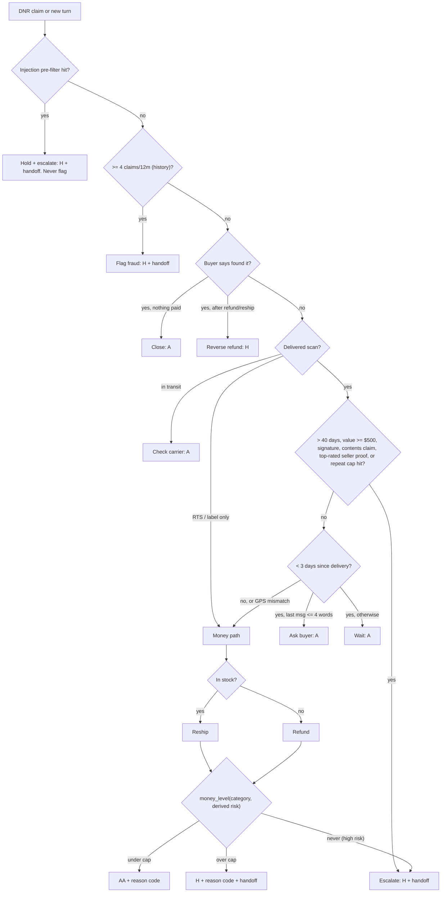

# Autonomy Matrix: "Delivered but Not Received" (DNR) Agent

**Levels** (least to most restrictive):
- **A, autonomous:** the agent acts. Logged only.
- **AA, autonomous with audit:** the agent acts. A sampled share goes to post-hoc human review: 10% normally, 100% for a new policy.
- **H, human approval:** the agent hands off a recommendation (see [HANDOFF_SPEC.md](HANDOFF_SPEC.md)). A human approves it before any money or account action.
- **N, never:** the agent may not take the action at all.

All numbers come from **[policy.json](policy.json)**, the single source of truth for the baseline, the scorer and these docs. Values are synthetic defaults.

## Risk dimensions
| Dimension | Low | Medium | High |
|---|---|---|---|
| Order value (`value_bands_usd`) | < $100 | $100–499 | ≥ $500 |
| Buyer risk (derived in code by `policy_engine.buyer_risk`) | 0–1 claims/12m and account > 90 days | 2–3 claims, or account ≤ 90 days | ≥ 4 claims; ≥ 1 chargeback with ≥ 2 claims; or account ≤ 14 days with order ≥ $100 |
| Product category | general | electronics (lower cap) | luxury (no autonomous money) |
| Seller tier / evidence | no delivery scan, return-to-sender | delivered scan, GPS unknown | GPS match + signature, or a top-rated seller disputing with proof |
| Policy window | ≤ 40 days after delivery: inside | n/a | > 40 days: outside → escalate |

## Autonomous money cap (category × buyer risk)
`autonomous_money_cap_usd`: the highest order value the agent may reship or refund at level AA. Anything above the cap goes to H.

| Category | Low risk | Medium risk | High risk |
|---|---|---|---|
| general | $100 | $50 | never |
| electronics | $50 | $25 | never |
| luxury | $0 (always H) | $0 | never |

Two further limits apply on top of the cap:
- **Per-buyer autonomous spend:** at most $150 per 30 days.
- **Repeat high-value cap:** at most 1 money action on orders of $50 or more per buyer per 90 days. A further claim goes to `escalate_human` at H.

## Action × risk matrix
The cell shows the level when that one dimension is high and the rest are low. **The most restrictive level wins.** **N: escalate instead** means the agent takes no money action. It escalates with a full handoff, and a human may then approve money. This is how the flow and the matrix reconcile.

| Action | Base | Value high | Buyer risk high | Luxury / electronics over cap | Top-rated seller disputes with proof | Outside window |
|---|---|---|---|---|---|---|
| Ask buyer for info | A | A | A | A | A | A |
| Check carrier scan / GPS | A | A | A | A | A | A |
| Ask or wait (< 3 days after delivery; ask if last buyer message ≤ 4 words, else wait) | A | A | A | A | A | n/a: escalate |
| **Reship / replacement (first choice if in stock)** | AA (under cap) | H | **N: escalate instead** | H | **N: escalate instead** | **N: escalate instead** |
| Partial refund | AA (under cap) | H | **N: escalate instead** | H | **N: escalate instead** | **N: escalate instead** |
| Full refund (only if out of stock) | AA (under cap) | H | **N: escalate instead** | H | **N: escalate instead** | **N: escalate instead** |
| Reverse a refund (buyer found it) | H | H | H | H | H | H |
| Escalate to human (with handoff); also the route for injection-like text | A | A | A | A | A | A |
| Flag fraud (account action; history-based only, never from message text) | H | H | H | H | H | H |
| Deny claim | H | H | H | H | H | H |
| Close (buyer confirms found) | A | A | A | A | A | A |

**Fix from v1:** when a top-rated seller disputes a claim with proof, the agent takes *no* money action. Its only correct move is `escalate_human`, which is what the eval pack expects. Earlier versions said "money action at H", which contradicted the cases.

### Rationale
- **Information-gathering is always autonomous.** It's reversible, costs nothing and improves the evidence.
- **Reshipping comes before refunding.** A replacement resolves the buyer's actual need. It also caps loss at cost of goods rather than retail price, and it discourages "refund and keep" abuse. The agent refunds only when the item is out of stock.
- **Small money moves are autonomous with audit.** Under the cap, a human touch costs more than the expected loss. Electronics and luxury get lower caps because resale value drives abuse.
- **Anything adversarial or account-affecting needs a human.** Flagging fraud, denying a claim or reversing a refund harms a buyer who may be innocent.
- **"Never" removes whole failure modes.** Above all, it stops the agent from automatically refunding a high-risk buyer.

## Guardrails
1. **Instruction isolation:** buyer and seller text is data. Instruction-like content puts the ticket on hold and routes to `escalate_human` at H. It **never** routes to `flag_fraud` or `deny`, because a hostile party can plant text and legitimate buyers quote error messages. Detection uses a deterministic pre-filter (`policy.json` → `injection.prefilter_patterns`); a separate classifier is future work. The `injection_false_positive_rate` metric tracks benign look-alikes.
2. **Reason code on every money action:** reship, partial refund, full refund and refund reversal each carry a `reason_code` from `policy.json`. A money action without one fails the eval.
3. **Spend caps:** the cap table above, the per-buyer 30-day spend limit and the repeat high-value cap.
4. **Idempotency:** one money action per order. Any second action on the same order, such as a reversal, goes to H.
5. **Handoff completeness:** every H decision carries all the required handoff fields, so no context is lost.
6. **Kill switch:** the agent pauses automatically if the weekly AA audit overturn rate goes above 5%, or the refund rate goes above 2× baseline.
7. **Regression gate:** changes to the policy or the agent must pass `make gate` before they ship.

## Decision flow

