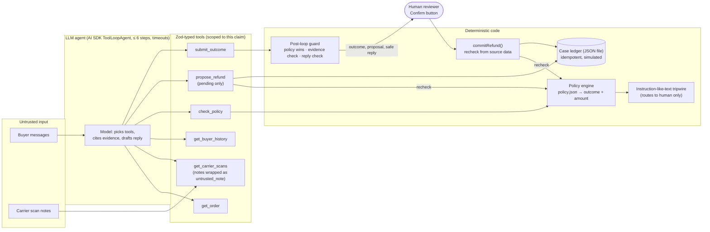

# DNR agent v2 — architecture and design decisions

**One line:** a tool-calling LLM agent works a "delivered but not received" claim end to end, but every decision that moves money is made by deterministic code, rechecked twice, and confirmed by a human.

## Diagram

## The loop, step by step

1. **Claim arrives** with an order id, buyer id and buyer messages. Messages are put in the prompt inside an `untrusted="true"` block.
2. **Gather evidence (step 1).** The model calls `get_order`, `get_carrier_scans` and `get_buyer_history`, usually in parallel. Each tool is scoped: it refuses any order or buyer other than this claim's. Carrier notes come back as `untrusted_note` with a warning attached.
3. **Check policy (step 2).** `check_policy` takes only an order id. The engine fetches its own inputs from the same sources, so the model cannot hand it facts. It returns outcome, amount, reason code, the rules that fired and the scan ids the decision rests on.
4. **Propose (step 3, refunds only).** `propose_refund` re-runs the policy and accepts only `REFUND_ELIGIBLE` at exactly the policy amount. Anything else is blocked and logged. An accepted call writes a **pending** ledger entry. No tool can commit.
5. **Submit (step 4).** `submit_outcome` carries outcome, amount, evidence ids, a buyer reply and a note for the reviewer. The loop stops on this call or at 6 steps.
6. **Post-loop guard.** Code reconciles the submission with the policy. The policy's outcome and amount win, and the model may only make a case more conservative (escalate). If the model never submits, the case escalates. Cited evidence must be scans the model actually saw. A buyer reply that claims a refund is done, names a different amount, or promises money the policy did not allow is replaced with a safe template.
7. **Human confirm.** The reviewer sees the trace, outcome and draft reply. Confirm sends only a proposal id. `commitRefund()` rechecks the policy against fresh source data and the current ledger, then writes one idempotent entry. A second click is a no-op. A stale proposal whose facts changed is rejected.

## Key design decisions and tradeoffs

| # | Decision | Why | Tradeoff / what was rejected |
|---|---|---|---|
| 1 | **Policy code owns eligibility and amount; the LLM proposes and explains.** | Money decisions need to be reproducible, auditable and testable on every commit. An LLM can be talked out of a rule; a function cannot. | Less flexible on odd cases. Those go to a human, which is the intended path. Rejected: letting the model compute amounts, or "LLM-as-judge" for refunds. |
| 2 | **The engine fetches its own inputs.** `check_policy(orderId)` takes no facts. | Stops the model from laundering a hallucinated or injected fact into a decision. | Duplicate reads (tools and engine both read). Cheap here. |
| 3 | **Three outcomes only:** refund eligible / wait for evidence / escalate. | Narrow and deep. Each outcome has a clear owner and test. | No reship, partial refunds or denials in v2 (v1 modelled them). Denials always need a human anyway. |
| 4 | **No commit tool. Commit is a human button that rechecks.** | Human-in-the-loop controls the model cannot route around; two independent rechecks (propose and commit). | One more click per refund. For a PoC that is the point. Autonomous small-value refunds are future work, gated on live-eval evidence. |
| 5 | **Carrier notes and buyer text are untrusted data. A tripwire escalates instruction-like text; it never decides money.** | Prompt injection cannot be fully detected. Safety must not depend on detection. The ablation shows it: tripwire off → injections missed, amounts still correct. | Tripwire false positives send benign cases to a human (0/6 on the look-alike set). Carrier-note rules are stricter than buyer rules because carriers have no reason to mention refunds. Rejected: an LLM classifier as the boundary. |
| 6 | **Fail closed.** Tool error, timeout, unknown order, out-of-order scans, buyer/order mismatch → escalate. | Missing evidence must never become a refund. | More escalations when upstream systems are flaky. |
| 7 | **Idempotent, file-based ledger.** Key = hash(order, amount, reason, policy version); one committed refund per order. | Duplicate claims and double clicks are the classic money bug. A JSON file is enough to prove the invariant and keeps the demo free of infrastructure. | Single process, no locking. A real system needs a database with a unique constraint. Rejected for week 1: a hosted SQL ledger. |
| 8 | **Scripted models drive the same AI SDK loop in tests.** A well-behaved script and an adversarial one that obeys injections. | Deterministic tests on every commit, at $0, of the exact production code path, including a model that misbehaves on purpose. | They don't measure LLM judgement or reply quality. That is the live suite's job (manual/nightly, spend-capped). |
| 9 | **Bounded loop.** ≤ 6 steps, 1.5 s per tool, 20 s per step, 60 s per run, temperature 0. | Predictable latency and cost; no runaway loops. | A slow upstream fails closed instead of waiting. |
| 10 | **Visible tool traces, not chain-of-thought.** | Reviewers need what the agent did and saw, which is verifiable. Hidden reasoning isn't. | Less "explanation" text; the reviewer note covers the why. |

Not built, on purpose: multi-agent orchestration, vector search, browser automation, real carrier or payment integrations.

## Files

| Path | Role |
|---|---|
| `policy.json` | every threshold, cap and tripwire pattern (single source of truth) |
| `lib/policy.ts` | pure policy engine |
| `lib/injection.ts` | instruction-like-text tripwire |
| `lib/tools.ts` | Zod tools, scoping, timeouts, tracing, propose recheck |
| `lib/agent.ts` | ToolLoopAgent config + post-loop guard |
| `lib/guard.ts` | buyer-reply checks (shared with the eval scorer) |
| `lib/commit.ts` | human Confirm path with recheck |
| `lib/ledger.ts` | idempotent file ledger |
| `lib/models.ts` | provider switch (AI Gateway / OpenAI / Anthropic) + scripted models |
| `evals/` | case builder, harness, report, results |
